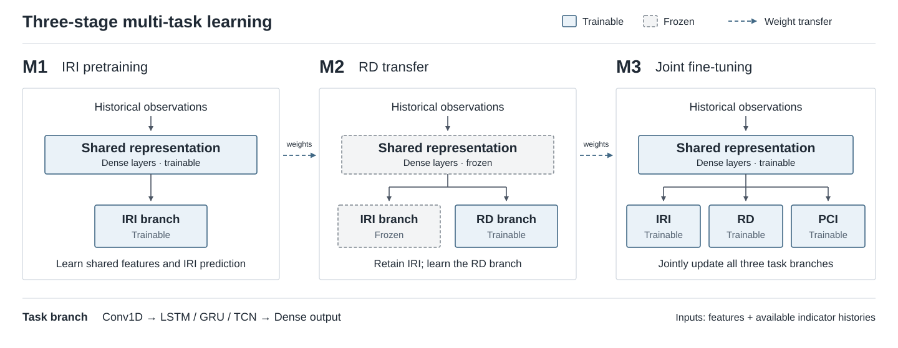
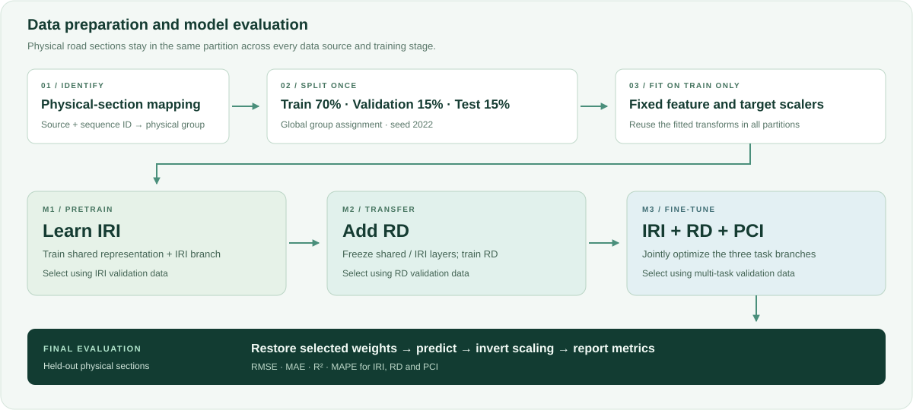

<p align="center">
  
</p>

<h1 align="center">Pave-ML</h1>
<p align="center"><strong>Multi-task learning for pavement performance indicators</strong></p>
<p align="center">
  
  
  
</p>
<p align="center">
  <a href="#overview">Overview</a> · <a href="#quick-start">Quick start</a> · <a href="docs/DATA_FORMAT.md">Data format</a> · <a href="#evaluation-protocol">Evaluation</a> · <a href="#outputs">Outputs</a>
</p>

## Overview

Pave-ML learns from pavement histories to predict **International Roughness Index (IRI)**, **rut depth (RD)** and **Pavement Condition Index (PCI)**. A shared dense representation feeds task-specific convolutional and temporal branches, with LSTM, GRU or TCN configurations and optional residual connections selected during tuning.

| Stage | Learning objective | Parameter updates |
| :--- | :--- | :--- |
| **M1 · Pretrain** | Learn IRI prediction | Shared representation and IRI branch |
| **M2 · Transfer** | Add RD prediction | RD branch; shared and IRI layers stay frozen |
| **M3 · Fine-tune** | Jointly predict IRI, RD and PCI | Shared representation and all task branches |

<p align="center">
  
</p>

## Quick start

Use **Python 3.11 or 3.12** and an isolated environment. Install the CPU environment:

```bash
python -m venv .venv
# Windows PowerShell: .venv\Scripts\Activate.ps1
# Linux / macOS: source .venv/bin/activate
python -m pip install -r requirements_tensorflow_cpu.txt
```

For NVIDIA GPU execution on Linux or WSL2, use `requirements_tensorflow_gpu.txt` instead. See the [TensorFlow installation guide](https://www.tensorflow.org/install/pip) for supported hardware and system requirements.

Place your three **headerless, comma-separated** data files in `txt_csv/`:

```text
txt_csv/
├── cleaned_result_array_IRI.txt
├── cleaned_result_array_RD.txt
└── cleaned_result_array_IRI_RDI_with_PCI.txt
```

Prepare your datasets and a `group_map.csv` with columns `source,id,group`, covering every sequence ID. The mapping connects dataset-specific IDs to the same **physical road section**, including separate IDs used for discontinuous observation periods. See the [format guide](docs/DATA_FORMAT.md) and [example mapping with fictional IDs](examples/group_map.example.csv).

```bash
python Multi-task-learning.py --data-dir txt_csv --group-map group_map.csv --output-dir runs
```

For a short execution check on your prepared data, reduce the search and training budgets:

```bash
python Multi-task-learning.py --data-dir txt_csv --group-map group_map.csv --output-dir runs --max-trials 1 --executions-per-trial 1 --tune-epochs 1 --train-epochs 1
```

<details>
<summary><strong>Training defaults and configuration</strong></summary>

| Option | Default | Meaning |
| :--- | ---: | :--- |
| `--seq-length` | `3` | Historical observations used to predict the next observation |
| `--seed` | `2022` | Group-split and training random seed |
| `--max-trials` | `40` | Maximum tuning trials per stage |
| `--executions-per-trial` | `3` | Training executions per trial |
| `--tune-epochs` | `30` | Maximum epochs per tuning execution |
| `--train-epochs` | `100` | Maximum epochs in the selected model's training run |
| `--patience` | `7` | Early-stopping patience |
| `--run-name` | timestamp | Name of the new directory inside `--output-dir` |

Run `python Multi-task-learning.py --help` for the full interface. Each invocation writes to a new run directory. Use a unique value for `--run-name`.

</details>

## Evaluation protocol

**Data partition.** Physical road sections are assigned to approximately **70% training, 15% validation and 15% test**, with the same assignment used across all sources and stages. Sequence windows preserve chronological order within each ID. These fractions apply to section counts.

**Preprocessing.** Feature and IRI scalers are fitted on M1 training rows, the RD scaler on M2 training rows, and the PCI scaler on M3 training rows. All stages use these fitted transforms, including for validation and test data. Sequence IDs serve as grouping metadata.

**Model selection and metrics.** Tuning, early stopping and weight selection use validation data. The selected models are evaluated on the test set in the original target units. Reports include **RMSE, MAE, R² and MAPE**; MAPE uses nonzero observed targets and records their count.

Missing target labels are masked in training and evaluation. Missing historical target values use the fixed input sentinel `100` after scaling. The [data guide](docs/DATA_FORMAT.md) describes the input channels and validation rules.

## Outputs

Runs are stored under `runs/<timestamp>/`, or under the name supplied through `--run-name`:

| Output | Contents |
| :--- | :--- |
| `config.json` | Run arguments and settings |
| `split_manifest.json` | Physical-group partition and data-split records |
| `preprocessing.joblib` | Fitted preprocessing state |
| `M1_hyperparameters.json` … `M3_hyperparameters.json` | Selected stage configurations |
| `M1_history.json` … `M3_history.json` | Training and validation histories |
| `checkpoints/` | Stage models and selected weights |
| `test_metrics.json` | Held-out evaluation metrics |
| `figures/` | Tuning summaries, loss curves, residuals and prediction plots |
| `run.log` | Console output from the run |

Keep the fitted preprocessing state together with its models: transferred branches depend on the same feature and target scales.

## Tests

Run the data and training tests from the repository root:

```bash
python -m unittest discover -s tests -p test_data.py -v
python -m unittest discover -s tests -p test_training.py -v
```

To exercise all three training stages using generated synthetic data:

```bash
python tests/smoke_training.py
```

The smoke test uses temporary files by default. Pass `--output-dir PATH` to retain its synthetic inputs and outputs.

## Repository map

```text
Multi-task-learning.py           Training, tuning and evaluation entry point
pave_ml/data.py                 Group-aware splitting and train-only preprocessing
requirements*.txt               Pinned direct dependencies and CPU/GPU entry points
docs/DATA_FORMAT.md              Input schema and section mapping
docs/assets/                    README illustrations
examples/group_map.example.csv  Fictional mapping example
tests/                          Data and training tests
```

**中文说明：** Pave-ML 通过 IRI 预训练、RD 迁移学习和三指标联合微调，预测路面 IRI、RD 与 PCI。运行时需提供三份观测数据及路段对应表；同一物理路段在各数据源中使用统一分组。数据格式见[说明文档](docs/DATA_FORMAT.md)。
